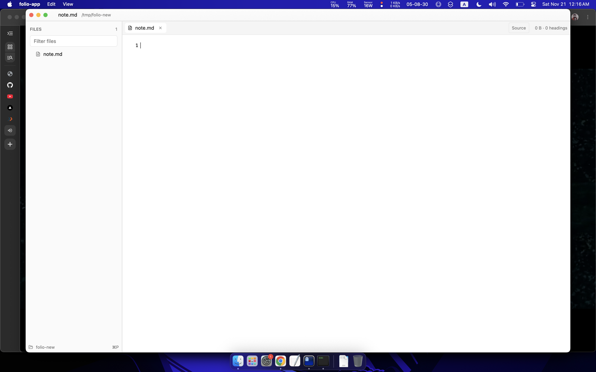

# Folio

[](https://github.com/mrsase/folio/actions/workflows/ci.yml)

A native macOS Markdown reader and editor. One window, a real folder tree, tabs,
a heading outline, find, fuzzy quick-open, live reload, and a source editor with
a rendered preview. GPU-rendered with GPUI; no web view, no Electron, no
telemetry.



## What it is for

Folio is for people who keep Markdown in folders and read or edit it every day:
notes, ADRs, runbooks, specifications. It opens any file or folder on the
machine, keeps the ones you use in a session, and saves without changing bytes
you did not edit.

## Status

v0.1.0 — [download the release](https://github.com/mrsase/folio/releases/tag/v0.1.0). The proof of concept remains readable at tag `poc-archive` (branch
`poc`); the product is a workspace with a pure-Rust core and a GPUI app.

## Build and run

Requirements: macOS 14+, stable Rust (pinned in `rust-toolchain.toml`), Xcode
command-line tools.

Clean clone:

```sh
git clone https://github.com/mrsase/folio.git
cd folio
cargo build --release --locked
```

From the repository:

```sh
cargo run --release -p folio-app            # restore the last session
cargo run --release -p folio-app -- .       # open this folder
cargo run --release -p folio-app -- docs/specimen.md
```

The first launch shows a welcome screen; nothing is scanned in the background
except the folder you open.

```sh
cargo test -p folio-core       # 85 tests, no GPU required
cargo test --workspace         # includes the app shell
./scripts/package.sh 0.1.0     # unsigned Folio.app + zip in target/
```

The packaged app is ad-hoc signed only. macOS will quarantine a downloaded zip;
if Gatekeeper refuses it:

```sh
xattr -dr com.apple.quarantine /Applications/Folio.app
open /Applications/Folio.app
```

There is no Developer ID signature or notarization. Build from source if you
prefer not to bypass Gatekeeper.

## Keyboard

| Shortcut | Action |
| --- | --- |
| `⌘O` / `⇧⌘O` | Open file / open folder |
| `⌘N` | New Markdown file |
| `⌘P` | Quick open: fuzzy files, or type an absolute / `~/` / relative path |
| `⌘E` | Toggle Source / Preview |
| `⌘S` / `⇧⌘S` | Save / Save As |
| `⌘F`, `⌘G`, `⇧⌘G` | Find, next, previous (find-only) |
| `⌘B` / `⇧⌘B` | Sidebar / outline |
| `⌘⇧L` | Toggle light / dark |
| `⌘⇧.` | Show hidden files |
| `⌘R` | Reload from disk |
| `⌘W` | Close tab (guarded when dirty) |
| `⌘⇧]` / `⌘⇧[`, `⌘1` / `⌘9` | Next / previous / first / last tab |
| `⌘,` | Settings |
| `⌘⇧R` / `⌘⇧F` | Reveal in Finder / open containing folder |
| `⌘Q` | Quit (guarded when dirty) |

Editor-native selection, `⌘Z` / `⇧⌘Z`, copy/cut/paste and `⌘A` come from the
shared input engine.

## Saving

- Files are read as UTF-8 only. A UTF-16 or invalid UTF-8 file opens with the
  reason and is never editable.
- A UTF-8 BOM, LF/CRLF/CR endings, mixed-ending head and tail lines, and the
  presence of a trailing newline are preserved. Untouched lines keep their exact
  terminators; new lines use the dominant ending.
- Writes go to a sibling temp file, are fsynced, keep the original mode, and are
  renamed over the target; the parent directory is fsynced. A failure before the
  rename leaves the original untouched.
- At save, `(dev, ino, size, mtime)` is compared with the stamp taken at load.
  If the file changed while the buffer was dirty, Folio stops and offers Reload
  / Overwrite / Save As / Cancel. A clean file reloads automatically.
- Dirty tabs are guarded on close and quit. Switching roots never closes tabs,
  so unsaved work survives a re-root.
- Task checkboxes write through the same path, changing one marker byte.

## Measured behaviour

Measured on macOS 14 (x64), 8 logical cores, release build unless stated.

| Metric | Result |
| --- | --- |
| Source | 7,929 lines (core + app + tests), 84 automated tests |
| Core tests | 85 pass (`cargo test -p folio-core`), 0.9 s |
| First frame, 2 KB document (debug build) | 802–1,089 ms |
| First frame, release build | 782–988 ms (2 KB); 693 ms (2 MiB preview); 986 ms (2 MiB source) |
| Release binary | 26,929,828 bytes (25.7 MiB) |
| CI | 27 m 41 s on `macos-latest` (clean checkout, fmt + clippy + tests + release) |
| Release build | 7 m 30 s first build; 2 m 19 s app-only rebuild |
| Preview render cap | 256 KiB (the PoC's measured limit) |
| Editable source | 2 MiB; read-only 2–8 MiB; preview-only 8–16 MiB |
| Largest file accepted | 16 MiB (preview head); above that, refused |

The full numbers, the build time and the go/no-go are in
[`docs/evaluation.md`](docs/evaluation.md).

## Limits

- macOS only.
- System theme is sampled at launch and when **System** is selected; a live macOS
  appearance change needs that selection or a relaunch.
- Source editor, not WYSIWYG; no split view, print/PDF, plugins, sync, iOS,
  multiple windows, or full-text search across a home directory.
- No notarization or Developer ID signing.
- 256 KiB of a large document is rendered and outlined; the rest is kept for saving.
- Above 512 KiB the source editor uses plain text instead of Markdown highlighting so the window stays responsive.
- Mixed line endings are preserved on untouched lines; edited/new lines use the
  dominant ending.
- Extended attributes (Finder tags, quarantine) and ACLs are not copied to the
  replacement inode.
- Quick-open indexes names only, bounded to depth 12, 50,000 entries, 20,000
  results and 3 seconds; it never follows symlinked directories.

## Architecture

```
folio-core/   documents, encoding/newlines, atomic writes, conflicts,
              checkbox bytes, paths, tree, index, recents, session, find
folio-app/    GPUI window, views, menus, shortcuts, editor, dialogs
vendor/gpui-pre-macos/  stable-Rust patch for gpui-pre-macos 0.3.12
```

`folio-core` has no GPUI dependency, so the byte-level contract is tested
without a window server. The app has one stateful view; views are plain
functions over that state. The PoC's single 1,902-line `app.rs` was not carried
forward.

`vendor/gpui-pre-macos` replaces three nightly-only `Option::map_or_default`
calls with `map_or_else`. It is wired through `[patch.crates-io]`; removing it
breaks stable builds when the dependency graph is resolved again.

## Roadmap

Each of these is deferred for a reason, not forgotten.

| Item | Why it is not in 0.1.0 |
| --- | --- |
| WYSIWYG editing | A Markdown serializer that round-trips every GFM construct is a project of its own and the main way documents get corrupted (ADR 0001). |
| Split view | Doubles layout, scroll and find state; the Source/Preview toggle covers the need at a fraction of the risk. |
| Print / PDF | Needs pagination outside GPUI's renderer; not a reading/editing requirement. |
| Plugins | No ABI, sandbox or versioning; a security surface with no v1 user. |
| Sync / cloud | Conflicts, accounts and encryption; the product is local-first. |
| Multiple windows | Session, watchers, menus and quit guards become per-window state (ADR 0002). |
| Full-home search | Expensive and privacy-sensitive; quick-open indexes names, not contents. |
| Notarization | Requires a paid Developer ID. |

## Proof of concept

Tag `poc-archive` and branch `poc` contain the reader-only Folio, including its
30 tests, for comparison and porting. It is not built by the workspace.

## License

MIT for Folio's original code. The vendored GPUI snapshot and dependencies are
attributed in [`THIRD_PARTY_NOTICES`](THIRD_PARTY_NOTICES).
